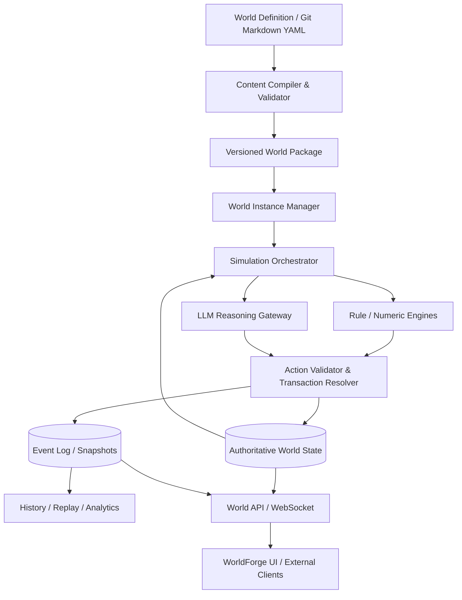

# WorldForge 2.0 设计文档

> 文档版本：V1.2（设计草案，已按当前仓库基线校正）  
> 日期：2026-10-13  
> 定位：世界观创作、结构化世界建模、多尺度世界模拟、历史生成与可视化平台  
> 状态：提案，待验证；本文的新架构、阈值和示例规则均非既定实现

> 本次校正以 [项目进展报告](PROJECT_PROGRESS_2026-10-13.md) 为实现基线。修订不批准任何新世界观 canon，也不代替后续技术 ADR。

## 0. 执行摘要

WorldForge 2.0 将当前已可运行的**世界观与卡牌创作工作台**扩展为**可计算、可推进、可追溯、可交互的世界模拟平台**。现有单页编辑器、Node 22 服务、SQLite 内容库、结构化 AI 候选和图像生成流程是迁移起点，不应被默认丢弃。平台仍以“世界定义 → 编译与校验 → 世界实例化 → 多尺度模拟 → 事件记录/历史回放 → 观察与干预”构成目标闭环，但通过增量纵切切片验证，不以全量重写为前置条件。

核心技术方向：

1. **规则引擎作为权威执行者**：人口、资源、经济、地理、战争和能力条件通过确定性或显式概率模型更新。
2. **LLM 作为情境决策与语义生成者**：为国家战略、组织行动、社会趋势、局部人物交互和场景细节提出候选行动、解释与细化内容。
3. **多尺度模拟**：世界/国家/地区/城镇/场景分层计算；按需提高局部精度并支持细节回聚。
4. **统一状态与因果事件**：每个可持久影响世界的变动都有可验证的动作、事务、结果和事件链。
5. **定义、作者草案与存档分离**：Git 管理已审查的世界设定；现有 SQLite 保存工作台运行时草案；未来独立的模拟表保存具体世界实例。三者必须通过显式发布/编译流程转换，不允许将 `proposed` 草案默认当作模拟真值。

### 产品边界（明确约束）

**赛博宠物为独立项目，不属于 WorldForge 2.0 的任何内部模块，也不是 WorldForge 运行的先决条件。** WorldForge 对外提供通用的世界观察、动作申请、事件订阅和存档查询 API。将来赛博宠物、真人客户端、其他 Agent 或游戏都可以作为外部消费者接入，但本设计不包含其生命循环、人格、记忆与桌面形象实现。

---

## 1. 项目背景与目标

### 1.1 继承 WorldForge 1.x 的能力

当前 WorldForge 已同时包含仓库内容源和可运行工作台。Git 中的 Markdown/YAML 用于已审查内容与设计文档，主要目录包括：

- `universe/`：宇宙级设定与跨世界约束。
- `worlds/`：各世界地域、历史与文明设定。
- `mechanics/`：魔法、科技、战斗等规则体系。
- `cards/`：卡牌 Schema、套牌索引与原型卡牌内容。

设定沿用状态治理：`canon`（已确认）、`proposed`（提案）、`deprecated`（废弃）。内容中的传闻和角色认知不应自动升级为客观事实。

可运行工作台已实现：

- 无前端构建依赖的单页应用，包含世界设定和卡牌设计两个模块。
- 13 类设定资料、世界—大陆—国家—城市—地点地理树、编年史容器/节点和独立背景故事。
- 卡牌三分类、四档稀有度、关键词、多设定来源以及设定到卡牌草案的可追溯联动。
- Node 22 内置 SQLite 持久化、整体内容 revision 冲突保护、完整 JSON 导出和旧浏览器数据迁移。
- 基于受限上下文与 JSON Schema 的 AI 候选生成，以及 Seedream / ComfyUI 卡面候选图流程。
- Docker Compose 本地部署与子路径运行支持。

上述能力是 2.0 的工程基线。其中的 SQLite “运行时内容”指作者编辑会话中的内容快照，不等于 2.0 将引入的“世界模拟实例状态”。

### 1.2 当前实现边界

截至 2026-10-13，项目尚未实现世界定义包编译器、世界实例、Tick 时钟、资源/人口/经济规则引擎、Action Validator、模拟事件日志、快照回放、分支历史、多尺度精度调度或外部 World API。现有“编年史”是作者编辑的设定资料，不是可重放的模拟事件日志。

### 1.3 V2.0 产品目标

- 允许用户创建世界模型，并在其规则约束下推进时间。
- 模拟大陆、国家、地区、城市、组织与人物的演化。
- 在重要决策和复杂社会现象中发挥 LLM 的推理与生成能力。
- 通过自适应模拟精度控制单机本地模型成本。
- 保证宏观数值、微观叙事、事件历史之间的一致性。
- 支持暂停、快进、观察、可审计干预和分支存档。
- 支持不同世界的多种运行规则，例如蒸汽工业、魔导文明、仙侠或科幻，而不硬编码特定题材。

### 1.4 非目标

- V2.0 不追求每一个普通居民都有独立 LLM 意识。
- 不让 LLM 自主覆盖权威世界状态、Git 正史或权限配置。
- 不将赛博宠物整合进 WorldForge 的仓库和生命周期。
- 首版不追求复杂实时物理、全场景 3D 渲染及全大陆逐人仿真。
- LLM 生成叙事不作为未经验证的历史事实。
- 首个可运行模拟切片不要求先将现有前端、Node 服务和 SQLite 全量重写。

## 2. 总体架构

本节的结构是目标架构，不是对当前实现的描述。当前产品是 `dist/` 单页前端 + `server.mjs` 模块化单体 + SQLite 内容库。2.0 应先在同一进程内建立清晰模块边界和最小纵切切片，只在实际吞吐、并发、安全或团队协作需求出现时拆分进程或服务。



### 2.1 子系统职责

| 模块 | 职责 | 权威范围 |
|---|---|---|
| Content Studio | 编辑卡牌、地理、文明、法则、编年史 | 修改源定义，受版本治理 |
| Content Compiler | Schema 校验、引用解析、世界包生成 | 生成只读、可版本化定义包 |
| Instance Manager | 世界创建、种子、快照、分支和归档 | 管理模拟实例生命周期 |
| Simulation Orchestrator | 世界时钟、任务队列、预算、精度调度 | 调度，不直接改世界数值 |
| Numeric/Rule Engines | 人口、经济、资源、战争、环境、魔法/科技规则 | 计算可核验的状态变化 |
| LLM Gateway | 情境摘要、策略提案、社会趋势与局部细节生成 | 非权威候选输出 |
| Action Validator | 前置条件、资源守恒、行动可行性和冲突检测 | 接收或拒绝动作 |
| State Store | 实体最新状态和关系 | 唯一权威状态 |
| Event & Snapshot Store | 可重放事件、因果关系和历史快照 | 权威历史证据 |
| Public World API | 观察、动作、干预、订阅、回放 | 通过权限控制访问 |

### 2.2 增量迁移原则

1. 现有 Content Studio 保持可用，不以前端框架迁移作为模拟开发前置条件。
2. 首先增加只读 Content Compiler，从经审核的内容产生带版本的 World Package。
3. 创作内容表与模拟实例表使用独立命名空间和写入接口；不将现有整体内容快照 API 扩充为模拟事务 API。
4. 以“一个定义包、一个实例、一种资源、少量行动、可重放事件”作为首个端到端验证。
5. 在纯规则推进稳定后再接入模拟用 LLM 提案，避免用文本生成掩盖事件与状态模型的缺失。

## 3. 世界数据模型：定义、实例与认知

### 3.1 四类数据必须分开

**作者工作区（Authoring Workspace）**：当前 SQLite 中的设定、卡牌、关键词、备注和美术候选。其中可包含 `proposed`、未完成条目和尚未同步到 Git 的草案，不是可直接实例化的权威定义。

**定义（Definition）**：从已审查内容编译得到的、只读且版本化的世界客观规律、初始地理、初始人物模板和文明描述。例如“魔晶能驱动蓄魔器”。

**实例状态（Runtime State）**：特定存档的世界时刻与演化结果，例如“317 年白炉城魔晶库存为 800 单位”。

**认知（Knowledge/Belief）**：某个人物、组织、地区已知、误解、隐瞒的信息。例如“城内传闻矿难系敌国破坏”，但这不等于真相。

工作区内容只能通过显式的“审核/发布 → 编译”步骤进入 Definition；Definition 只能通过创建实例进入 Runtime State。任何阶段都不得因为 LLM 或用户界面已显示某条内容而跳过这两个边界。

### 3.2 核心标识与一致性

```ts
type WorldInstance = {
  instanceId: string;
  worldId: string;
  definitionVersion: string;
  simulationRulesetVersion: string;
  seed: string;
  tick: number;
  status: 'paused' | 'running' | 'replaying' | 'archived';
};

type WorldEvent = {
  eventId: string;
  instanceId: string;
  tick: number;
  kind: string;
  actorId?: string;
  targetIds: string[];
  causeEventIds: string[];
  proposalId?: string;
  effects: unknown; // 由事件种类对应的 schema 校验
};
```

### 3.3 内容分级

`canon/proposed/deprecated` 用于管理作者认可程度；`objective_truth/in_world_belief/unknown` 用于区分世界事实与角色认知。这两组维度独立存在，避免“角色传言”变成系统权威事实。

### 3.4 世界扩展规则

世界机制优先由带版本的 **Ruleset + 参数 Schema + 事件/动作接口** 表达。魔法、灵力或蒸汽动力都是不同资源、能力和转换规则的插件，不要求模拟器为每种题材写一套完全独立的核心。

### 3.5 模拟机制注册系统

模拟核心只负责时钟、调度、权威状态、行动管线、事件提交和重放。魔法、修仙、蒸汽、科技、经济、政治与战争规则通过可版本化的机制模块注册，避免核心模拟器随世界类型增加而演变为题材判断 `if/else` 集合。

概念接口如下：

```ts
interface SimulationMechanic {
  id: string;                         // 全局稳定且命名空间化
  version: string;                    // 实例创建后锁定
  parameterSchema: JsonSchema;
  dependencies?: MechanicDependency[];

  initialize(context: WorldContext): WorldEffect[];

  getAvailableActions(
    context: MechanicReadContext
  ): ActionDefinition[];

  validate(
    action: WorldAction,
    context: MechanicReadContext
  ): ValidationResult;

  resolve(
    action: WorldAction,
    context: MechanicReadContext
  ): WorldEffect[];
}
```

`initialize` 和 `resolve` 返回效果候选，不直接写数据库。`MechanicReadContext` 是只读、受范围限制的状态视图；随机数只能由核心提供的可记录 PRNG 产生。Resolver 收集各机制输出后，统一执行 Schema、读写集、资源守恒、互斥性、状态版本与权限校验，再在单一事务中提交状态和事件。

注册表是 World Package 的一部分，每个定义包必须声明启用的机制 ID、精确版本、参数、依赖、动作/效果 Schema 和执行顺序约束。编译时拒绝缺失依赖、循环依赖、重复 ID、不兼容版本和未声明的状态写入。实例不随注册表升级而静默切换机制版本；升级必须通过显式迁移或创建新分支。

首版机制模块是仓库内受信任代码，不允许 World Package 携带任意可执行脚本。未来若允许第三方机制，必须先设计签名、能力权限、资源配额、超时与隔离执行方案。

### 3.6 模拟知识隔离

权威世界状态仅供规则引擎、Validator 和 Resolver 在最小必要范围内读取。国家、组织、人物和外部 Actor 的决策模型不得直接读取全局状态，必须通过 `KnowledgeView` 获得与主体身份相符的信息。

```ts
type KnowledgeRecord = {
  subjectId: string;
  proposition: unknown;
  sourceEventIds: string[];
  observedAtTick: number;
  confidence: number;
  classification: 'public' | 'restricted' | 'secret';
  status: 'observed' | 'inferred' | 'reported' | 'deception';
  expiresAtTick?: number;
};
```

知识视图遵守以下规则：

- 只包含主体亲历事件、公开信息、合法共享记录、情报行动结果和基于这些材料生成的推断；未知信息保持未知。
- 推断必须保留来源、观测时间、置信度和不确定范围。A 国只能根据边境活动、侦察结果和外交信息估计 B 国秘密兵力，不能读取 B 国真实部署表。
- 错误情报、宣传、伪装和过时信息作为显式记录存在；它们可以影响决策，但不会覆盖 `objective_truth`。
- 组织知识不自动等于每个成员的知识；共享范围由角色、部门、通信路径和保密等级决定。
- Agent 提示词、工具结果、缓存与记忆均使用同一个知识过滤器。禁止先读取全局状态再要求模型“假装不知道”。
- Validator 可以使用客观状态拒绝不可能的行动，但返回给 Actor 的拒绝原因必须经过知识过滤，不能借错误信息泄露隐藏事实。
- 事件提交后只向具备观察条件的主体生成知识记录；世界事件日志和主体知识日志分别保存并可独立审计。

知识记录参与快照、分支和重放。重放时根据已提交的观测/传播事件重建主体知识，不从目标 Tick 的客观状态反向补全。

## 4. 多尺度模拟模型

| 层次 | 主要对象 | 典型推进 | 默认引擎 | LLM 角色 |
|---|---|---|---|---|
| L0 世界 | 气候、全球贸易、文明传播、时代环境 | 年/季度 | 规则与数学模型 | 重大世界事件候选 |
| L1 国家/大地区 | 财政、外交、战争、人口、政策 | 月/季度 | 状态机、数值模型 | 战略决策、政策设计、复杂趋势解释 |
| L2 城市/组织 | 市场、公会、企业、治安、社会矛盾 | 周/月 | 状态机、组织 Agent | 组织博弈、局部社会演化 |
| L3 人物/场景 | 对话、探索、调查、技能使用、冲突 | 行动/事件 | 权限化动作 + 局部规则 | 主要交互和计划生成 |

说明：推进频率是示例默认值；应当由世界 Ruleset 与运行预算配置决定，不能假设所有题材都适用。

### 4.1 跨尺度同步

- **自上而下**：战争导致贸易封锁 → 城市库存减少 → 工坊减产 → 人物失业。
- **自下而上**：工匠发明能源装置 → 工坊产能提高 → 城市经济变化 → 国家政策调整。
- 同一变量只能有一个权威所有者。各层提交操作与事件，避免多个引擎直接改同一数值。
- 对人口、库存、预算、土地等总量使用守恒或上/下界校验，防止局部实例化凭空创造资产。

## 5. 大模型参与宏观模拟：区域语义推演

### 5.1 总原则

LLM 不仅为局部场景写对白，还可以为国家、大地区、组织提供细致的**计划、政策组合和社会事件候选**。但 LLM 没有直接修改最终状态的权限。

### 5.2 宏观模拟流程

1. 规则引擎更新区域关键指标与待处理矛盾。
2. 摘要器组装事实、近期事件、行动限制、主体目标和可用动作。
3. LLM 返回结构化 `RegionalProposal`（包含目标、行动序列、依据与可观测后果）。
4. Validator 校验主体权限、资源、路径、技术前置条件与事件互斥性。
5. Resolver 统一排程，处理多个地区的竞争与交易。
6. 数值引擎推进生产、消费、战争、政策效果。
7. 生成事件、更新状态、储存候选与裁决记录。
8. 按重要性决定是否再次让 LLM 反思失败结果。

```json
{
  "proposal_id": "prp_001",
  "actor_id": "council_whiteforge",
  "goal": "alleviate_energy_crisis",
  "justification_event_ids": ["evt_supply_shortage"],
  "actions": [
    {"kind": "ration_resource", "resource_id": "mana_crystal", "priority_sector": "medical"},
    {"kind": "negotiate_trade", "counterparty_id": "southern_league", "resource_id": "mana_crystal"},
    {"kind": "fund_research", "topic_id": "alternative_power", "budget": 400}
  ],
  "expected_side_effects": ["industrial_output_down", "public_support_mixed"]
}
```

### 5.3 细致更新不等于直接填数

LLM 可以提出“行会囤货”“议会削减民用魔力配额”“反魔导思潮增长”；系统将其转换为组织行动、舆情趋势和政策，再由规则引擎结算。不能接受未经计算的“城市失业率上升 18%”作为直接写入指令。

**软状态**（舆论、信任、社会趋势）也应结构化：记录参与群体、传播范围、影响强度、证据链、时间衰减，并配置变更边界。叙事文本仅是这些状态的解释和呈现。

### 5.4 对抗性决策

外交、商业交易与战争涉及多个主体，不能由某一方的 LLM 直接宣布对方接受。采用各主体独立提案 → 双方约束检查 → 谈判/博弈/规则结算 → 统一提交的协议。

## 6. 自适应模拟精度（Adaptive Simulation Resolution）

### 6.1 计算预算分配

每个区域基于以下因素评分：

- 重要性：人口、生产力、交通枢纽、政治权重。
- 变动性：近期战事、危机、突发政策、重大交易。
- 观察关联：当前用户聚焦区域、外部客户端活跃地点。
- 未解事件：外交争端、组织冲突、正在进行的任务。
- 新鲜度：距离上次 LLM 复核的模拟时间。

综合优先级与全局计算预算决定 LLM 使用频率。预算不仅是 token 上限，还包含单位模拟时间的调用次数、并发槽位、等待时间、上下文长度、云端费用上限和可选能耗指标。阈值必须可配置且用压测数据调整。

LLM 预算调度器同时根据任务的能力需求进行模型路由：

| 任务 | 默认模型策略 | 失败或超额时 |
|---|---|---|
| 简单社会趋势分析 | 本地小模型 | 降级为统计阈值/规则标签 |
| 城市或组织决策 | 本地主力模型 | 使用保守策略或延后到后续 Tick |
| 国家重大政策与多方谈判 | 更强的本地模型；云端需显式允许 | 分解任务、转人工审批或采用可解释的保守动作 |
| 历史叙事润色 | 便宜文本模型 | 保留结构化事件摘要，延迟叙事生成 |
| 结构化校验、权限、资源守恒 | 优先程序与 Schema，不调用 LLM | 校验失败即拒绝或进入明确的人工处理队列 |

模型路由不按供应商名称硬编码，而是按 `structured_output`、`planning`、`long_context`、`low_latency`、`local_only` 等能力标签和已测性能级别选择。任务的数据敏感级别可禁止云端路由；默认保持本地优先。每次路由必须记录任务类型、优先级、选中模型与版本、预算估算与实耗、降级原因和最终结果，便于家庭服务器在 NAS + Mac Studio 等异构资源上调度与审计。

### 6.2 按需细化（Lazy Materialization）

远景模拟只保存聚合指标及少量固定实体。当用户打开城市或外部 Agent 进入场景时：

1. 从权威聚合状态与历史事件编译局部约束。
2. 优先复用已存在的地点、人物和组织。
3. 使用确定性生成器构建数量、结构与可计算属性。
4. 使用 LLM 生成符合约束的名称、社会关系、背景故事、日常冲突候选。
5. 验证新实体不能超出人口/资源/历史一致性限制。
6. 为持久交互实体分配稳定 ID；临时装饰实体可缓存并按策略淘汰。

### 6.3 回聚（Aggregation）

离开细节区域后，可减少 NPC 精度和推理频率，但已落地的交易、死亡、库存、关系、研究成果等必须保留。回聚仅汇总可安全压缩的统计数据，不能抹掉会影响未来因果的具体实体。

### 6.4 抖动控制

地区精度升级和降级采用不同阈值与最短驻留时间，避免用户反复切换镜头时大量生成和销毁实体。

## 7. 核心引擎设计

### 7.1 资源与经济

实体通过生产、消费、贸易、税收、储备和损耗改变状态。区域库存与运输在时间推进时结算，避免跨地区重复使用同一批资源。初版可用简单商品流模型，后续再引入价格、信用与供应链。

### 7.2 人口与社会

人口以人口组（cohort）模拟出生、死亡、迁徙、职业与阶层。只有重要人物或已实例化角色拥有独立行为状态。社会趋势由事件驱动并受到历史、传播路径和组织影响。

### 7.3 国家、外交与战争

国家 AI 可通过 LLM 选择战争目标、政策和外交动作；开战条件、兵力、补给、行军、战损、领土变化由规则引擎结算。战争事件更新人口、经济与合法性，进一步影响政权稳定。

### 7.4 科技、魔法与文明演进

技术用依赖图、资源条件、研究积累与传播路径建模。LLM 可以提出新技术方向或组合，但必须匹配底层可执行机制、前置知识、材料和社会条件。设定作者可将全新技术批准为规则扩展；未批准的设计只作为研究假说，不会自动形成宇宙新法则。

### 7.5 历史事件生成

历史不是预写的一条时间线，而是世界实例推进后得到的事件图。可生成不同叙事视角：客观事件年表、某国官方史、人物日记、民间传说；后面几种可能有偏见，不改变事件事实。

## 8. 世界时间、运行模式与可复现性

### 8.1 时间体系

- `world_tick` 为权威逻辑时间。
- 现实时间只决定何时执行工作，不直接作为世界因果依据。
- 快进时按粒度批量结算；关键事件自动中断或细化。
- 同一 Tick 中按：收集提案 → 校验 → 冲突解决 → 提交 → 事件发布顺序执行。

### 8.2 运行模式

**历史推演模式**：按年/月高速推进，重视宏观历史、成本与稳定性；关键节点调用 LLM。

**活世界模式**：按较短周期推进，当前聚焦区域细化，支持暂停、交互、检查和干预。

**实验对比模式**：相同初始包与随机种子，在“纯规则”和“混合 LLM”配置下分别运行，比较一致性、丰富度与计算成本。

### 8.3 重放与确定性边界

- 随机事件使用可记录的 PRNG 种子和抽样值。
- LLM 请求、模型版本、提示词版本、结构化响应、校验结果、批准动作均归档。
- **重放采用已提交事件，不重新向 LLM 采样**；因此可回放既有历史，但无法保证再次推理生成相同候选。
- 允许从快照分支出不同平行历史；分支继承定义版本和起始事件链。

## 9. LLM Gateway 与提示词/工具协议

当前工作台已有服务端 LLM 代理，支持 OpenAI Responses 风格和兼容 Chat Completions 风格的请求，并已实现候选 JSON Schema、格式修复、上下文预算和提示词分层。2.0 的 LLM Gateway 应抽取并复用这些机制，而不是建立第二套不相容调用链。Ollama 仍是本地模型候选，但是否增加专用 Adapter 应根据实际接口差异验证，不视为已实现。系统必须不依赖某个具体模型。每次模拟调用指定任务类别、响应 JSON Schema、最大 tokens、超时、重试次数和可接受风险。

### 9.1 任务类型

- `strategy_proposal`：国家/组织行动方案。
- `regional_analysis`：区域矛盾与情境分析。
- `social_trend_proposal`：社会趋势与传播路径候选。
- `local_materialization`：场景细化、人物背景提案。
- `dialogue`：允许交互时的 NPC 语言表达。
- `history_narration`：根据已提交事件编写史书文字。

### 9.2 防幻觉与降级

- 输入只包含由主体 `KnowledgeView` 编译的可知事实、传闻、推断及其置信度，以及对该主体可用的行动 Schema。
- 内部国家/组织 Agent 与外部 Actor 使用同一知识隔离管线；系统不向模型提供隐藏真值后再依赖文本指令要求它忽略。
- 输出必须可解析、可验证；自由文本只能进入叙事字段。
- 模型无响应、超时或多次生成违规方案时，使用规则 AI、保守动作或延后决策，确保世界时钟不会因 LLM 故障停摆。
- 将玩家与外部客户端传来的文本视为不可信数据；不得将其作为系统指令。

### 9.3 LLM 模拟预算调度器

所有模拟用 LLM 调用必须通过统一调度器，不允许机制模块、国家 Agent 或 UI 绕过调度器直接调用供应商。

```ts
type LlmTaskRequest = {
  taskType: string;
  actorId?: string;
  regionId?: string;
  priority: number;
  deadlineTick?: number;
  capabilityRequirements: string[];
  dataPolicy: 'local_only' | 'cloud_allowed';
  maxInputTokens: number;
  maxOutputTokens: number;
  maxLatencyMs: number;
  fallbackPolicy: string;
};
```

调度决策顺序为：

1. 判断任务是否可以由规则、缓存或既有事件结果完成；可完成时不调用 LLM。
2. 根据区域优先级、事件重要性、截止 Tick、任务能力和数据策略选择候选模型池。
3. 检查实例、区域、任务类型和全局四层预算，防止一个热点区域耗尽全部推理资源。
4. 预留并发槽位与费用，执行调用，按实际 token、延迟和错误结算。
5. 超额、超时或模型不可用时，按声明的降级链转小模型、纯规则、延迟或人工审批；不得静默切换到不符合数据策略的云端模型。

任务路由与模型能力配置是带版本的运行规则。快照需要保留对应配置版本；事件或提案记录需要保留模型 ID/版本、提示词版本、知识视图摘要哈希、路由原因与资源实耗。历史重放使用已提交结果，不因当前调度器选择了不同模型而重新生成过去。

## 10. 状态存储与一致性协议

首个单机原型继续使用现有 SQLite，但在同一数据库中为模拟实例建立独立表、迁移版本和事务边界。这样可以用最低迁移成本验证“动作 → 校验 → 状态变更 + 事件”的原子提交。异步任务使用幂等键消重。

当且仅当出现已测量的多进程 Worker 并发、多用户写入、远程部署、大规模空间查询或 SQLite 写入吞吐瓶颈时，再通过 ADR 评估 PostgreSQL、Prisma 与 PostGIS。目标模型不依赖 SQLite 特有语义，以保留后续迁移路径。

推荐核心表：

```text
world_definitions
world_definition_versions
world_instances
mechanic_registrations
entities
entity_components
regions
region_state
resources_and_balances
relations
simulation_jobs
llm_budget_ledger
llm_routing_decisions
llm_proposals
world_actions
world_events
world_snapshots
knowledge_records
```

这些表是模拟域目标，与当前 `lore_entries`、`card_drafts`、`keywords`、`notes` 和 `art_assets` 等创作域表并存。不得将一个创作内容 revision 当作一个世界 Tick。

必须保证：

1. 一个实例只存在一条已提交的权威状态时间线。
2. 每次状态修改都对应被接受的 Action/Event。
3. 校验状态版本，拒绝基于过期快照提交的竞争操作。
4. 所有写操作都有角色身份、授权范围、原因与审计日志。

## 11. 对外接口：通用世界访问协议

WorldForge 对外只暴露通用世界服务，而不内置特定宠物或玩家客户端。

当前已有 `/api/health`、`/api/content`、`/api/settings`、AI 候选和图像生成等作者工作台接口。模拟接口应使用明确的 `/api/instances/...` 边界，不改变现有 `/api/content` 的创作快照语义。在模拟数据模型稳定前，不承诺对外兼容性；稳定后再为通用 World API 设定显式版本。

### 11.1 推荐端点（概念草案）

```http
GET  /api/worlds
POST /api/instances
GET  /api/instances/{id}/state
GET  /api/instances/{id}/regions/{regionId}
GET  /api/instances/{id}/entities/{entityId}
GET  /api/instances/{id}/events?sinceTick=...
POST /api/instances/{id}/actions
POST /api/instances/{id}/control/pause
POST /api/instances/{id}/control/step
POST /api/instances/{id}/control/branch
GET  /api/instances/{id}/history
WS   /api/instances/{id}/stream
```

### 11.2 权限模型

- `observer`：只读已授权的世界信息。
- `actor`：控制被授权的角色/组织，仅通过 Action API 操作。
- `operator`：控制实例时间、暂停和分支。
- `author`：编辑世界定义并发布版本。

对玩家或外部 Agent 必须采用**角色视角过滤**，避免通过 API 查询未发现的隐藏事实。管理员/作者视角另行授权。

同样的角色视角过滤适用于系统内部的国家、组织与人物 Agent。`author` 或系统 Validator 的全局可见性不得被决策 Agent 继承。同一个主体通过 UI、LLM Gateway 或外部 API 访问时，必须得到等价的 `KnowledgeView`。

外部赛博宠物未来可以调用 `observe`/`actions`/`events`，但它的需求系统、LLM 思维链、个性、个人长期记忆、桌面 UI 均在它自己的项目中实现。

## 12. 前端设计

当前单页工作台已有“世界设定编辑器”和“卡牌设计”两个模块。首版应保留它们，并逐步增加下列工作区，不要求先完成框架重写：

1. **世界编辑器（现有，继续增强）**：内容版本、卡牌关系、Schema 错误与正史提案审查。
2. **世界观察器**：多图层地图、区域指标、国家边界、关键实体、事件热区。
3. **模拟控制台**：实例创建、时间速度、暂停/单步、LLM 预算、精度覆盖。
4. **历史实验室**：年表、事件因果图、快照比较、分支历史及国家发展曲线。

卡牌设计模块继续作为创作域的独立工具，不在 2.0 M0/M1 中强行与世界模拟规则绑定。

局部展开时显示城市、组织、人物与场景；任何生成细节都标示来源与持久化状态（已确认为实例事实 / 待审批提案 / 仅叙事装饰）。

## 13. 技术栈与部署

技术选择分为当前基线和条件式迁移：

- **当前前端**：无构建依赖的 HTML/CSS/JavaScript 单页应用。M0/M1 可在现有模块上增加最小界面；当状态管理、可视化复杂度或团队并行开发成为实际瓶颈时，再用 ADR 评估 TypeScript + React + Vite。
- **当前 API / 应用层**：零第三方运行时依赖的 Node 22 服务。先将内容、模拟、LLM 和图像边界模块化；在需要强类型大型团队 API 框架时再评估 NestJS。
- **规则模拟与调度**：首先作为独立模块和可从命令行运行的纯规则循环；证明会阻塞 HTTP 服务或需要并行后再拆为 Worker。
- **数据库**：M0/M1 使用现有 SQLite 并增加显式迁移；当并发、远程或空间查询需求通过压测成立后，再评估 PostgreSQL / Prisma / PostGIS。
- **队列**：原型阶段使用 SQLite 任务表或进程内调度；只在吞吐和可恢复性指标不达标时引入 Redis/BullMQ 或其他外部队列。
- **LLM**：复用现有 Responses / 兼容 Chat Completions 代理与 JSON Schema 校验；Ollama 通过兼容层或专用 Adapter 接入，具体方式由原型决定。
- **可视化**：现有地理树是唯一地点内容源；地图画布、多边形或图结构在原型压测后选型，不另建平行地理数据库。
- **部署**：继续使用现有 Docker Compose 与单机本地优先模式；后续按实测负载拆分服务。

### 13.1 建议增量仓库结构

```text
worldforge/
├── dist/                     # 现有工作台前端
├── server.mjs               # 现有 HTTP 入口，逐步瘦身
├── storage.mjs              # 现有创作内容存储
├── universe/
├── worlds/
├── mechanics/
├── cards/
├── schemas/                  # 定义包、动作、事件 Schema
├── simulation/
│   ├── compiler/             # 内容到世界定义包
│   ├── rules/                # 纯规则更新
│   ├── runtime/              # 实例、Tick、Action、Event
│   └── storage/              # 模拟表与迁移
├── scripts/
├── tests/
└── compose.yaml
```

当模块边界、多包发布或独立部署需求成立后，可再迁移为 `apps/` + `packages/` + `services/` 的 monorepo，而不在 M0 中先行重排整个仓库。

**特意不包含 `cyber-pet/` 目录。** 外部应用以独立 Git 仓库、部署、数据和权限存在。

## 14. 运行示例：魔导城市能源危机

本章节仅为测试用场景，不代表已确认的 W01 正史。

初始：一座人口 30 万的魔导工业城市，魔晶储备仅能支撑约 23 天。供应中断导致价格变化，工坊与议会形成利益冲突。

- **Tick 1（规则）**：库存下降，价格上涨，制造业产能受限。
- **Tick 2（LLM 组织规划）**：行会提出配额计划；市议会提议临时进口；黑市组织准备囤货。
- **Tick 3（验证与结算）**：验证预算、运输时间、库存来源和主体权限；拒绝不可执行方案。
- **Tick 4（规则）**：工业就业、财政与供应链状态变化。
- **Tick 5（LLM 社会趋势）**：根据失业、供应限制、传播网络提出抗议事件候选。
- **Tick 6（验证/事件）**：满足条件则触发集会、谈判等事件，否则记录趋势积累。
- **Tick 7（历史）**：根据提交事件生成客观年表，并可从城民、议会、行会视角生成不同叙述。

观察者放大到工坊街区时，从已存在的组织、工坊与人口约束中实例化重点人物和具体场景；离开后回聚到城市统计。

## 15. 质量属性与评测

### 15.1 正确性

- 人口、资源、资金、领土及人物位置不出现无因凭空增长/复制。
- 行动验证通过率、被拒绝原因分布可追溯。
- 历史事件因果链可追溯；关键世界事实不会因叙事而改变。
- 同一实例快照 + 事件日志可准确重放到目标 Tick。

### 15.2 模拟品质

- 事件多样性：同种危机在不同政治经济环境下产生合理差异。
- 长期一致性：技术、政策、地理、文化后果不会在数十年后消失。
- 因果可解释性：用户能找到重要变化的驱动因素。
- 自主性：重要组织可提出未预写但合法的策略组合。

### 15.3 性能

- 每推进一个世界年消耗的 CPU 时间、LLM tokens 与等待时间。
- 局部细化延迟与持久实体增长速度。
- 同时活跃地区数量与 Worker 吞吐。
- 快进、暂停、恢复与快照所需时间。

### 15.4 A/B 基准

以相同世界初始状态和随机种子对比纯规则/混合 LLM 模式；统计守恒违规、不可执行动作、事件多样性、剧情相关性、长期自洽性和总计算成本。LLM 固有随机性通过重复试验与事件归档处理。

### 15.5 当前工程基线

截至 2026-10-13，当前 `npm run check` 包含核心脚本语法检查和 38 项 Node 测试，本次核查全部通过。这些测试覆盖内容工作台、SQLite 持久化与前向迁移、AI 候选、地理树、编年史、卡牌兼容、图像通道 mock，以及 M0B 定义编译、机制依赖和实例化基础；尚不覆盖 Tick、行动结算、快照或重放。

## 16. 分期开发路线

### V2.0-M0A：基线固化与数据边界

**状态：已完成（2026-10-13）。** 发布/编译边界见 [ADR-0008](adr/ADR-0008-authoring-definition-boundary.md)，存储迁移与模拟命名边界见 [ADR-0009](adr/ADR-0009-content-schema-migrations.md)。

- 维护由 `init` 首次提交建立的可追溯 Git 基线，保持本机数据、数据库与密钥在版本库外。
- 定义 Git 已审查内容、SQLite 作者工作区与可实例化 Definition 的发布边界。
- 为现有 SQLite 补充显式 Schema 迁移策略，并为模拟域预留独立命名空间。
- 验收：已明确“默认只发布 `canon`，`proposed` 只能显式进入实验包”；新建内容库可从版本 0 顺序迁移至当前版本，v1 数据可无损升级，未来版本会被拒绝打开。

### V2.0-M0B：定义编译与实例基础

**状态：已完成（2026-10-13）。** 发布清单已由作者确定使用 JSON，契约见 [ADR-0010](adr/ADR-0010-json-world-package-contract.md)。

- 构建内容 Schema 和世界包编译器。
- 支持 `worldId/definitionVersion/instanceId`。
- 定义模拟机制注册表、稳定 ID/版本、参数 Schema、依赖图和动作/效果命名空间。
- 创建基础实体、地区与事件表。
- 首版使用 SQLite 和当前 Node 服务，不要求先迁移技术栈。
- 验收：W01 最小清单可确定性编译为只读、带版本和 SHA-256 哈希的定义包，并实例化成可读取的独立 SQLite 存档；未显式发布的 `proposed` 内容不会默认编入；缺失、循环或版本不兼容的机制依赖均有编译期失败测试。

### V2.0-M1：纯规则宏观模拟

- 先交付一个城市、两个行为主体、一种核心资源和三种行动的能源危机纵切切片。
- 建立世界时钟、资源流、行动校验、事件日志、随机种子和快照。
- 建立主体知识记录、观测/传播事件和 `KnowledgeView` 编译器，即使 M1 不调用 LLM，规则 Agent 也不得使用全局真值。
- 验收：无 LLM 时可确定性地推进、从快照与已提交事件重放到目标 Tick，资源守恒和过期状态写入检查通过；两个主体在同一 Tick 可以拥有不同且可重放的知识视图。
- 纵切切片通过后，再扩展到一国三城、多组织和多资源的快速十年模拟目标。

### V2.0-M2：LLM 区域语义模拟

- 在现有 LLM 代理之上添加模拟任务 Schema、结构化提案、规则校验和失败降级；验证 Ollama 兼容层或专用 Adapter。
- 实现基于任务能力、区域优先级、本地/云端数据策略、token/延迟/并发/费用配额的 LLM 预算调度器。
- 组织与国家可自主制定可执行政策。
- 验收：危机处理中出现多样化且合法的策略；模型中断或预算耗尽不会阻塞模拟；云端不会接收 `local_only` 数据；A 国的提案不包含未经情报获得的 B 国秘密状态。

### V2.0-M3：局部细化与回聚

- 实现城市/街区按需实例化，永久实体与临时实体分层。
- 支持观察者视角和角色知识过滤。
- 验收：局部进入、离开、再次进入后保持已发生事实的一致性。

### V2.0-M4：历史实验室与外部接口

- 可视化地图、年表、因果链、分支和存档对比。
- 发布通用 SDK 与有限权限 Action API。
- 验收：独立客户端可在不修改 WorldForge 源码的情况下观察实例、提交合法动作、订阅结果。

## 17. 关键风险与缓解

| 风险 | 影响 | 缓解 |
|---|---|---|
| LLM 幻觉事实 | 破坏世界设定 | 事实/提案隔离、Schema、Validator |
| LLM 过度频繁 | 推理成本高、时间推进缓慢 | 分级调用、缓存、预算、失败降级 |
| 宏微状态不一致 | 凭空生成居民与资源 | 权威状态、物化约束、回聚规则 |
| 生成世界缺乏因果 | “看起来热闹但不真实” | 基于可计算行动和事件链接 |
| 并发提案冲突 | 重复消费资源、NPC 多处出现 | 单实例事务排序、幂等、状态版本 |
| 内容规则频繁变化 | 存档不可用 | 定义版本锁定、显式迁移/分支 |
| 复杂度过早膨胀 | 长期无法得到可运行 MVP | 从单城市、单资源危机纵切切片验证开始 |
| 过早重写已有产品 | 大量时间用于平移而非验证模拟 | 以现有 Node/SQLite/单页应用完成首个纵切切片，用指标触发迁移 |
| 创作快照与模拟状态混用 | `proposed` 内容或整体快照被误作世界真值 | 独立发布/编译边界、独立模拟表与接口 |
| Git 基线纳入本机数据或密钥 | 运行时内容、数据库或凭据泄露 | 由 `init` 提交建立基线，并持续维护 `.gitignore`、提交前密钥检查与差异审查 |
| 机制模块直接写状态或相互覆盖 | 重放不确定、规则组合爆炸 | 只读上下文、效果候选、声明式读写集与统一 Resolver |
| Agent 获得上帝视角 | 战争、间谍和外交博弈失真 | 内外 Agent 统一 `KnowledgeView`，记录来源、置信度、时效与欺骗 |
| 模型路由只看 token 或静默转云端 | 任务质量失控、费用或隐私超限 | 能力标签路由、多维配额、`local_only` 硬边界与可审计降级链 |

## 18. 仍待决策的设计问题

1. 哪些工作区内容可进入 World Package：仅 `canon`，还是允许作者显式勾选的 `proposed` 内容作为试验输入？
2. 首个模拟原型使用 W01 的非正史测试场景，还是使用完全独立的合成世界？
3. 地理数据采用 Voronoi 行省、手绘多边形，还是两者混合？任何方案都必须以现有 `location.parentId` 地理树为内容源。
4. 模拟时间以日为最小单位，还是允许行动级细分？
5. 国家/组织 Agent 的决策权限、情报共享范围、知识衰减与欺骗机制如何配置？
6. 地区从远景切换到精细场景时，永久实体生成阈值如何定？
7. 科技/魔法规则支持到多大程度的用户自定义脚本？
8. 多个世界是否共享一套宇宙规则，以及跨世界事件如何执行？
9. LLM 生成事件需要自动落地、规则确认或作者审批的具体判别条件？
10. 什么可测指标触发从 SQLite 迁移 PostgreSQL，以及从现有单页应用迁移 TypeScript/React？
11. 机制注册表首版只允许仓库内受信任模块，还是需要在 2.0 内支持第三方沙箱机制？
12. 家庭服务器的默认预算设定是按实例、现实时间窗口，还是每推进一个世界年分配？云端路由是否始终需要单独开关？

这些问题不阻止 M0/M1 开发；建议通过最小实验世界验证后再固化。

---

## 19. 一句话定位

**WorldForge 2.0 是一个以规则维护客观世界、以 LLM 提供情境智能、以多尺度计算生成连续历史的世界创作与模拟平台。** 它可被外部角色、游戏或 Agent 使用，但不会与任何一个特定客户端（包括赛博宠物）绑定。
